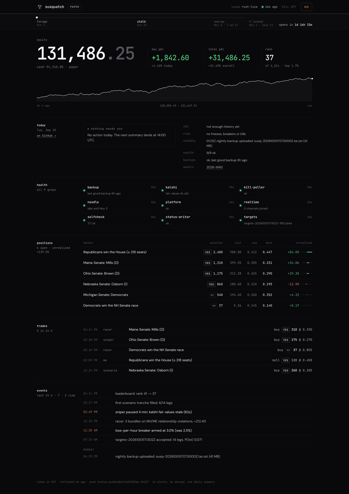
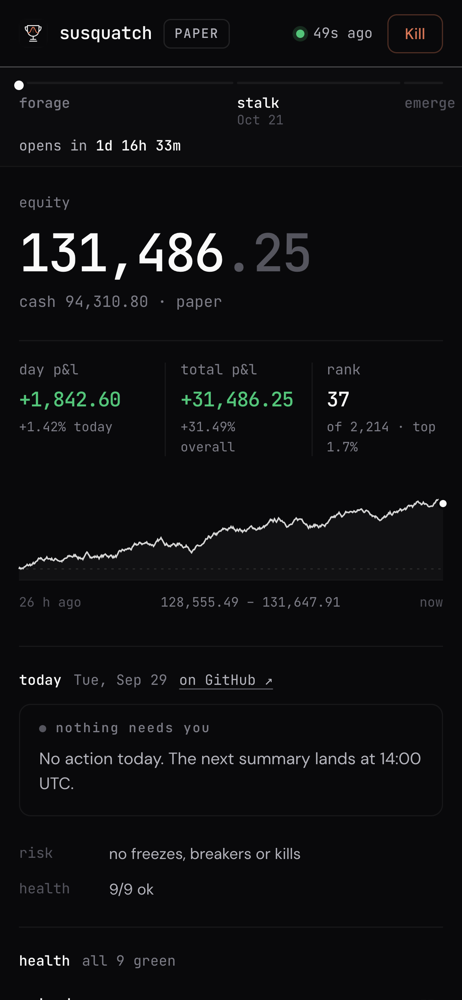

# Operations: the $0/month layer

`ops` · `docker-compose` · `azure-for-students` · `cloudflare-pages` · `workers-kv` · `backblaze-b2` · `cron-worker` · `dead-man-switch`

Susquatch runs unattended on a small ARM box, reports to nobody in real time, and costs its owner nothing: no card is
on file anywhere. This document is how.
Three rules shape every decision below ([`brief/OPS_FREE_AUTONOMY.md`](../brief/OPS_FREE_AUTONOMY.md) is the authority):

1. **$0 out of pocket, no card anywhere.** Every service is on a free tier with headroom, except the server, which is
   paid from the one-time Azure for Students credit. `make costs` proves it or fails.
2. **No alerts.** One daily summary, plus a dashboard you choose to open. Anything that "would have paged" becomes an
   **ACTION NEEDED** line in that summary.
3. **Fail safe, heal yourself.** Restart what died, restart what hung, refuse what's stale, cancel at the lock. A dead
   server is itself reported, by a Worker that doesn't live on the server.

<p align="center">
  
  &nbsp;
  
</p>

---

## 1. The shape of it

```
 ┌──────────────── Azure for Students B2pls_v2 (aarch64, 2 vCPU / 4 GB), or the Mac fallback via colima ─────────┐
 │  systemd: susquatch.service ── docker compose (ops/compose.yaml) ─────────────────────────────────────────────┐ │
 │    nats · python-scheduler (research) · bridge | rust-live · needle ← research, trading, models              │ │
 │    status-pusher ──── state/status.json ─▶ POST /api/push  (every 150 s, 120 s on election night)            │ │
 │    kill-poller   ◀─── GET /api/kill (every 10 s) ─▶ writes ops/KILL (never deletes it)                       │ │
 │    watchdog ── docker-proxy (list + restart only) ; post-lock ops/KILL at 16:55Z Nov 4                       │ │
 │  timers: backup 07:30Z → B2 · selfcheck 13:30Z · priority on 23:00Z Nov 3 / off 17:00Z Nov 4                │ │
 └──────────────────────────────────────────────────────────┬────────────────────────────────────────────────────┘
                                                            │ HTTPS out only (Azure NSG + ufw: nothing in but SSH from one IP)
 ┌──────────────────────── Cloudflare (free) ───────────────▼────────────────────────────────────────────────────┐
 │  Pages "susquatch" → https://susquatch.pages.dev   login page + session cookie, noindex                         │
 │     /api/push (server) · /api/status · /api/kill · /api/summary        KV "SUSQ_KV": status · kill · summary:* │
 │  Worker "susquatch-summary"  cron 0 14 * * *  → summary:latest (dashboard) + comment on the pinned           │
 │     "Daily summary" issue in the private susquatch-reports repo (GitHub emails you)                           │
 └───────────────────────────────────────────────────────────────────────────────────────────────────────────────┘
 ┌──────────────── Backblaze B2 (free 10 GB, no card: uploads stop at the cap) ──────────────────────────────────┐
 │  private bucket, key scoped to it ← nightly tar.zst snapshots (80 % quota guard)                              │
 └───────────────────────────────────────────────────────────────────────────────────────────────────────────────┘
```

Every piece is in the repo: [`ops/cloud-init.yaml`](../ops/cloud-init.yaml), [`ops/install.sh`](../ops/install.sh),
[`ops/compose.yaml`](../ops/compose.yaml), [`ops/docker/`](../ops/docker), [`ops/systemd/`](../ops/systemd),
[`ops/launchd/`](../ops/launchd), [`dashboard/`](../dashboard), [`worker/`](../worker),
[`py/susq/ops/`](../py/susq/ops). Secrets live only in `.env` on the host and in Cloudflare/GitHub secret stores.

## 2. Services

| Service | Image | Profile | CPU weight | Memory | Health | Notes |
|---|---|---|---|---|---|---|
| `nats` | `nats:2.12-alpine` | always | 3072 | 96 MB | `:8222/healthz` | the bus; not published anywhere |
| `rust-live` | `ops/docker/rust.Dockerfile` | `rust` | 4096 | 640 MB | `127.0.0.1:9101/healthz` (in-container) | `susq-live run $SUSQ_LIVE_FLAGS` (`--election` on Nov 3–4); needs `SUSQ_API_KEY` or it exits and Docker backs off; 30 s stop grace for cancel-all; OOM score −800 |
| `bridge` | python | `bridge` | 4096 | 512 MB | `python -m susq.ops.healthcheck bridge` | `susq-bridge open` ([bridge_py/README.md](../bridge_py/README.md)); healthy while waiting for the key or the open, then status/journal must move within 10 min; retired after the cutover |
| `needle` | `ops/docker/cpp.Dockerfile` | `election` | 3072 | 256 MB | none: rust-live's needle watchdog (heartbeat on NATS) | `susq-needle --prior state/needle/prior.json` (`SUSQ_NEEDLE_PRIOR`); cnats via `cpp/cmake/deps.cmake`; a missing prior makes it exit and Compose back off |
| `python-scheduler` | python (with the `susq_models` C++ extension) | always | 256, **capped 1.5 CPU** | 1.5 GB | `state/research/scheduler.json` < 600 s old | `susq research run`; never trades; OOM score +500 (dies first) |
| `status-pusher` | python | always | 1024 | 96 MB | loop | [`status_push.py`](../py/susq/ops/status_push.py) |
| `kill-poller` | python | always | 2048 | 96 MB | loop | [`kill_poller.py`](../py/susq/ops/kill_poller.py) |
| `watchdog` | python | always | 1024 | 96 MB | heartbeat file | [`watchdog.py`](../py/susq/ops/watchdog.py) |
| `docker-proxy` | `wollomatic/socket-proxy:1` | always | 512 | 32 MB | n/a | allows `GET /containers/json` and `POST /containers/{id}/restart`, nothing else |

Pick profiles with `COMPOSE_PROFILES` in `.env` (`bridge` on Oct 1; `rust` after the cutover; add `election` for Nov 3–4).
The research scheduler always runs.

The memory column is a ceiling per container, not a reservation. The caps sum to 3,360 MiB on purpose, so that every
service, the `bridge` and `election` profiles included, fits on the 4 GB B2pls_v2 together with about 700 MB for the
kernel, Docker and a co-tenant; the budget is spelled out at the top of [`ops/compose.yaml`](../ops/compose.yaml).
Measured so far: the scheduler's telemetry job peaked at 1.3 GB on Oct 6 (the Oct 5 OOM incident), which is why it gets
1.5 GB rather than 2 GB; the needle's model is tiny; the bridge and rust-live resident sizes have **not** been measured
under load, so check `docker stats` and `free -m` (and the kernel's OOM count in `dmesg`) in the Oct 8 needle smoke and
in both rehearsals before trusting the split, and raise one cap only by lowering another. The stack idles near zero
CPU, which suits a burstable VM (30 % baseline, credits banked while idle). install.sh adds 4 GB of swap for the first
native image builds.

**The bridge reads `.env` itself** (a read-only mount, not `env_file`), so it starts the moment `SUSQ_API_KEY` lands
there: no restart needed. Edit `.env` in place (`nano` does); an editor that saves by replacing the file isn't seen
through a single-file mount, in which case `docker compose … restart bridge`.

The bridge and rust-live may run side by side: the trader lease, enforced in
both gateways, guarantees only one of them ever places orders.

**Hardening, all services:** read-only root filesystem, `cap_drop: ALL`, `no-new-privileges`, non-root user (the
checkout's owner, so bind mounts just work), log rotation (3 × 10 MB). **No ports are published at all**: Docker-published ports bypass ufw, so
"don't publish" is the firewall. Health and metrics stay inside each container (rust-live insists on a loopback
address): `docker compose --project-directory . -f ops/compose.yaml exec rust-live curl -s 127.0.0.1:9101/metrics`.

**Health contract for service owners.** Every process that should be supervised serves `GET /healthz` (200 = healthy)
inside its container on the port above, via `SUSQ_METRICS_ADDR` (the research scheduler proves liveness through its
`scheduler.json` instead, which the status pusher also turns into the `research` health tile; the bridge is checked
by [`susq.ops.healthcheck`](../py/susq/ops/healthcheck.py)). Compose marks it unhealthy after 3 failures, and the watchdog restarts
it (max 3 per hour, then an ACTION NEEDED item instead of a crash loop). A process that *exits* is restarted by
Compose itself (`restart: unless-stopped`).

## 3. What it costs you: nothing (`make costs`)

| Service | Free limit | Our design budget | Guard |
|---|---|---|---|
| Azure for Students VM | one-time $100 credit, no card; when it runs out the subscription is disabled, never billed | `Standard_B2pls_v2` + static IP + 30 GB StandardSSD ≈ $34/month: ≈ $41 to the Nov 4 lock, ≈ $72 to Nov 30 | `make costs` fails on anything bigger than B2pls_v2; **no Pay-As-You-Go upgrade is a human check** |
| GitHub Actions (private) | 2,000 min/month | ~2 min per dashboard deploy + CI | billing summary API: any `netAmount > 0` fails |
| Workers + Pages Functions | 100,000 requests/day | ~13,700/day (8,640 kill polls, ≤720 pushes, one open tab) | computed from config every run |
| Workers KV writes | 1,000/day | ≤ 732/day (push budget 800 hard-capped at 720 by cadence, +2 summary, +kill) | pusher's daily budget; Functions refuse pushes < 100 s apart |
| Workers KV reads | 100,000/day | ~18,000/day | |
| Pages | 500 builds/month | 0 (direct upload) | |
| Backblaze B2 | 10 GB stored, free forever, no card: uploads stop at the cap instead of billing; transactions free | a few hundred MB | `backup.sh` refuses at 80 % (or when it can't measure) |
| Claude routines | Pro 5/day | ~1.1/day (daily + weekly) | extra usage OFF (human check) |

`make costs` prints this with live numbers wherever a free API can see them (GitHub billing with a `Plan: read` token,
Cloudflare subscriptions with a `Billing: read` token, `rclone size`, the pusher's counter). It degrades to
"unmeasured" without credentials, and **exits 1 if anything would cost money** (for the server: if it is bigger than
the credit was planned for). It always ends with the human checklist:

- [ ] Azure subscription is **Azure for Students** (no card, credit-funded); **no Pay-As-You-Go upgrade**
- [ ] Claude "extra usage" is OFF
- [ ] Cloudflare is on the Workers Free plan (no card on file)
- [ ] Backblaze B2 has no card on file, so the 10 GB cap stops uploads instead of billing
- [ ] GitHub spending limit is $0

## 4. Secrets: where each one lives

| Secret | Lives in | Set by | Scope / permissions |
|---|---|---|---|
| `SUSQ_API_KEY` | server `.env` | you | Super Market key, `read` + `trade` |
| `SUSQ_STATUS_PUSH_TOKEN` | server `.env` **and** Pages secret (same value) | you | ≥ 32 random chars (`openssl rand -base64 36`). Opens only `/api/push` and `/api/kill` |
| `DASHBOARD_PASSWORD` | Pages secret | you | ≥ 16 chars; the login page's password. Also accepted as HTTP Basic (any username) by curl and the tests. Sessions are HMAC cookies keyed from it, so changing it signs every browser out |
| `SUSQ_R2_ACCESS_KEY_ID` / `SUSQ_R2_SECRET_ACCESS_KEY` | server `.env` | you | Backblaze B2 application key, **read & write, restricted to the one private bucket**. With it: `SUSQ_R2_ENDPOINT=https://s3.<region>.backblazeb2.com`, `SUSQ_R2_PROVIDER=Other`, `SUSQ_R2_BUCKET`. The `R2` in the names is history: they configure any S3 bucket, and without an endpoint they fall back to Cloudflare R2 via `CLOUDFLARE_ACCOUNT_ID` |
| `GITHUB_TOKEN` (Worker) | Worker secret | you / CI | fine-grained PAT on `susquatch-reports` only: **Issues: read & write**, optional **Contents: read** (weekly link) |
| `CLOUDFLARE_API_TOKEN` | GitHub Actions secret | you | Account → **Cloudflare Pages: Edit**, **Workers Scripts: Edit**, **Workers KV Storage: Edit** |
| `CLOUDFLARE_ACCOUNT_ID`, `SUSQ_KV_NAMESPACE_ID` | GitHub Actions secrets (or variable) | you | not secret, but account-specific |
| read-only deploy key | `/root/.ssh/susq_deploy_key` via cloud-init | you | GitHub deploy key, **read-only** |
| `SUSQ_EXPIRES_*` | server `.env` | you | expiry dates, so the self-check warns 14 days ahead |

Nothing secret is committed: `.env`, `.dev.vars` and `*.key` are gitignored and gitleaks runs in the pre-commit hook
and CI. KV namespace ids are placeholders that CI substitutes.

## 5. Cloudflare, once (≈10 minutes, then it deploys itself)

```bash
cd dashboard && npm install
npx wrangler login                                          # or export CLOUDFLARE_API_TOKEN
npx wrangler kv namespace create SUSQ_KV                    # note the id
```

Backups don't use Cloudflare: R2 needs a card on file, so the bucket lives on Backblaze B2 (§7).

1. **GitHub → Settings → Secrets → Actions:** `CLOUDFLARE_API_TOKEN` (permissions above), `CLOUDFLARE_ACCOUNT_ID`,
   `SUSQ_KV_NAMESPACE_ID`. Optional, and synced on every deploy: `DASHBOARD_PASSWORD`, `SUSQ_STATUS_PUSH_TOKEN`,
   `SUSQ_REPORTS_GITHUB_TOKEN`.
2. Push to `main` (or `make deploy-cloudflare`). [`deploy-cloudflare.yml`](../.github/workflows/deploy-cloudflare.yml)
   tests, creates the `susquatch` Pages project if needed (so the URL is exactly `https://susquatch.pages.dev`), deploys
   Pages + Functions and the Worker. Without the three required values it **skips with a notice** instead of failing.
3. In `susquatch-reports`, the Worker creates an open issue labelled `daily-summary` on its first run. **Pin it and watch
   it.** Its comments are your daily email.

## 6. Bringing it up

### Azure for Students (primary)

Paid from the one-time $100 student credit with no card on file. The student subscription only allows `norwayeast`,
`westus`, `belgiumcentral`, `francecentral` and `mexicocentral`; we use `westus`.

1. Fill a copy of [`ops/cloud-init.yaml`](../ops/cloud-init.yaml) (its three placeholders) somewhere that is never
   committed, e.g. `ops/state/azure/cloud-init.yaml`. It clones the repo and runs `ops/install.sh`, which is
   idempotent: re-run it any time.
2. Create the VM. `Standard_B2pls_v2` is Arm (Ampere, 2 vCPU burstable, 4 GB). It doesn't support Trusted Launch, so
   the security type must be `Standard`. `--nsg-rule NONE` starts with no inbound rules; the next command opens SSH to
   your IP only.

   ```bash
   az group create --name susquatch --location westus
   az vm create --resource-group susquatch --name susquatch \
     --image Canonical:ubuntu-24_04-lts:server-arm64:latest \
     --size Standard_B2pls_v2 --security-type Standard \
     --admin-username ubuntu --ssh-key-values ~/.ssh/id_ed25519.pub \
     --os-disk-size-gb 30 --storage-sku StandardSSD_LRS \
     --public-ip-sku Standard --public-ip-address-allocation static \
     --nsg-rule NONE \
     --custom-data ops/state/azure/cloud-init.yaml
   az network nsg rule create --resource-group susquatch --nsg-name susquatchNSG --name ssh-from-me \
     --priority 1000 --direction Inbound --access Allow --protocol Tcp --destination-port-ranges 22 \
     --source-address-prefixes "$(curl -s https://api.ipify.org)/32"
   az vm show -d --resource-group susquatch --name susquatch --query publicIps -o tsv
   ```

   If your home IP changes, re-run the rule command with `az network nsg rule update` and the new address.
3. `ssh ubuntu@<ip>`, fill `/opt/susquatch/.env`, then `sudo systemctl restart susquatch` (or `make restore` to come
   back from the newest backup). First start builds every image natively (no cross-compiling), about 10–15 minutes.
4. `make selfcheck && make costs`, then open the dashboard. The heartbeat goes green within about 3 minutes.

The same cloud-init file and install script also work unchanged on Oracle's Always Free A1, which was the original
plan; Oracle needs a card on file, so it isn't used.

### The Mac (fallback)

```bash
brew install colima docker docker-compose docker-buildx rclone zstd uv
ops/launchd/install.sh            # stack at login (kept alive), nightly backup, daily self-check
ops/launchd/install.sh --remove   # when the server is back
```

The same compose file runs under colima on Apple Silicon (aarch64, same images). **Run one host at a time**: stop the
other first (`ssh … 'sudo systemctl stop susquatch'`). Two hosts means two lease holders on two machines, which is
exactly the split brain a local lease can't see. Keep the Mac awake on election night.

## 7. Backups and the restore drill

[`ops/backup.sh`](../ops/backup.sh), nightly at 07:30 UTC (03:30 ET):

- `tar` of `state/ journal/ data/ reports/ targets/` → `zstd -12` → `susq-<UTC>.tar.zst` + `.sha256`, uploaded with
  rclone's S3 backend to `<bucket>/susquatch/daily/` on Backblaze B2. Credentials come from env (no `rclone.conf`
  on disk).
- Retention: **7 dailies**; Sunday's copy is promoted to `weekly/` and **4 weeklies** are kept. Every object is a full
  snapshot, so there are no delta chains to compact and any single object restores on its own. (Raw collector deltas
  are compacted into daily Parquet by the collectors themselves, before they ever reach a backup.)
- **Quota guard:** the whole bucket is measured first. If `used + archive ≥ 80 %` of B2's free 10 GB, or if the bucket **can't be
  measured**, the upload is refused, the archive stays in `ops/state/backup-staging/`, and an ACTION NEEDED item
  appears. The item clears itself on the next good backup.
- Never backed up: `.env`, `ops/` (so never `ops/GO_LIVE`). A restored host comes back **in paper mode** until you re-arm it.
- Election night: the nightly slot would land mid-count, so it's deferred. The priority-off unit takes the backup at
  the lock (17:00Z Nov 4) instead.

[`ops/restore.sh`](../ops/restore.sh): **one command from a fresh host to running.** It picks the newest archive (or
`--archive NAME`), verifies the sha256 **before touching anything**, stops the stack, *moves* existing data to
`.pre-restore-<UTC>/` (never deletes), extracts, and starts the stack. Target: cloud-init → `.env` → `make restore`
in **under 30 minutes**, most of it the first image build.

**Verified (2026-09-28):** [`ops/tests/backup_restore_drill.sh`](../ops/tests/backup_restore_drill.sh) runs both scripts
against a real S3 API (`rclone serve s3` standing in for the bucket, through the same `provider=Other` remote B2 uses), 28 checks:
retention, weekly promotion, the 80 % guard, refusal when the bucket can't be measured, recovery clearing the item,
restore into a fresh home with byte-identical data, restore over existing data (moved aside), and a tampered archive
rejected before anything changes. `uv run pytest py/tests/ops` runs it whenever rclone and zstd are installed.
**Verified against B2 (2026-09-30):** a real nightly backup uploaded, `restore.sh --list` saw it, and the archive's
sha256 matched after a download round trip.

### The credit runway, and what happens when it ends

The server costs about $34 a month of the $100 credit: about $41 through the Nov 4 lock and about $72 through Nov 30,
so there is room to spare at this size and none for a bigger one (`make costs` fails if the VM grows). Azure has no
idle-reclaim policy, so a quiet stack is never taken away for looking idle. When the credit runs out, or the
subscription period ends, Azure **disables** the subscription and stops the VM. It never bills, because there is no
card to bill. Recovery is the same as any lost host: the Mac fallback (§6) and `make restore` from the newest backup in
B2. Meanwhile every order carries a GTD expiry, so nothing we left resting outlives the host by more than its TTL, and
the summary Worker, which runs on Cloudflare, reports "server silent since …" the next morning. Check the remaining
credit in the Azure portal (Subscriptions) now and then.

## 8. Status, Kill, and the KV budget

- **Status.** The lease holder writes `state/status.json` (a `StatusSnapshot`). The pusher reads it every 15 s so it
  never misses an event between pushes, adds what only ops knows (is `ops/KILL` on disk, is the writer stale, backup /
  self-check / poller health, open ACTION NEEDED items) and pushes every 150 s (120 s in the election window). One push
  = **one KV write** of the `status` record: latest snapshot, a ~30 h equity history for the sparkline, and a ring of
  timestamped events.
- **Kill.** Dashboard → dialog with a written reason, then a press-and-hold → `kill` KV flag. The kill poller (10 s) writes `ops/KILL`, and every
  gateway checks it before every write: cancel-all, then freeze. Typical latency is seconds; worst case is roughly
  10 s poll + KV's ~60 s global propagation. **`touch ops/KILL` over SSH is instant and always works.**
  The poller never deletes `ops/KILL`, and the browser cannot un-kill. **Un-kill = `make unkill` on the server**
  (clears the flag first; if that fails it removes nothing).
- **Staleness.** The dashboard calls the server silent after 7 minutes (`STALE_AFTER_S=420`); the summary Worker after
  20 (`DEADMAN_MINUTES`).
- **After the lock:** the watchdog writes `ops/KILL` at 16:55Z Nov 4 whatever else is true, backing up the gateways' own
  time gate and the GTD expiry on every order.

## 9. The daily summary (the only message you get)

At 14:00 UTC (07:00 PT) the Worker composes, **in this order**: the dead-man line ("server silent since X"), **ACTION
NEEDED** (empty most days), equity / 24 h / day P&L / total P&L / rank of field, stage · mode · trader · kill,
freezes & risk events, notable events, health, backup freshness, and the weekly review link (the newest
`weekly/*.md` in the reports repo). It lands on the dashboard (`summary:latest`) and, unless `PUSH_TO_GITHUB=false`,
as a comment on the pinned issue. A rerun the same day never posts twice. If GitHub refuses, the dashboard's copy says so.

**ACTION NEEDED sources:** `ops/state/actions/<key>.txt`, one file per item, written by the self-check (`selfcheck-*`),
`backup.sh` (`r2-quota`), the watchdog (`watchdog-<service>`), the pusher and the poller (config, budget, reachability),
plus whatever the trading processes put in their snapshot. Each clears itself once the condition is gone.

## 10. Self-check (13:30 UTC daily, `make selfcheck`)

| Check | Warns | Down → ACTION NEEDED | Fixes itself |
|---|---|---|---|
| disk | < 15 % free | < 5 % | deletes backup staging older than a day |
| clock | ≥ 2 s drift | ≥ 5 s (median vs HTTP `Date` from 3 hosts) | chrony does; this checks it |
| expiry | ≤ 14 days to any `SUSQ_EXPIRES_*` | expired | |
| tls | upstream cert < 7 days | | reported only (not ours to renew) |
| lease | | nobody holds it after the open, or it expired > 60 s ago | |
| backup | | none in 30 h | |
| quotas | B2 ≥ 68 % | B2 ≥ 80 % | |

## 11. Election-night priority (Nov 3 18:00 ET → Nov 4 12:00 ET)

The server's 2 vCPUs are shared with **calshi** whenever it runs on the same host, a separate project whose repo we
don't edit. Two layers:

1. **Always on:** cgroup v2 CPU weights in `compose.yaml` (rust-live/bridge 4096, needle/nats 3072, kill-poller 2048,
   helpers 1024, scheduler 256 + a 1.5-CPU cap). Weights only matter under contention, and then the trading path wins.
2. **The window:** `susq-priority-on.timer` (23:00Z Nov 3) runs `ops/priority.sh election`, which drops the weight of
   our scheduler **and calshi's non-critical containers** (`SUSQ_COTENANT_THROTTLE`, default
   `backfill|research|batch|scheduler`) to 128 with `docker update`, and of any calshi systemd units you list in
   `SUSQ_COTENANT_UNITS` to `CPUWeight=10` (`systemctl set-property --runtime`). Its order-handling services are never
   touched. `susq-priority-off.timer` (17:00Z Nov 4) restores every recorded weight exactly and takes the post-lock
   backup. The stack unit re-applies `auto` on boot, so a reboot mid-window stays throttled. Nothing is stopped and
   nothing is hard-capped, so calshi keeps running, just second.

## 12. Tests and verification

| What | Command | Verified |
|---|---|---|
| ops helpers (pusher, poller, self-check, watchdog, healthcheck, costs) | `uv run pytest py/tests/ops` | 71 tests, mocked HTTP |
| backup / restore against a real S3 API | `ops/tests/backup_restore_drill.sh` | 28 checks |
| install.sh ×2 on Ubuntu 24.04 arm64 + cloud-init schema + systemd verify | `ops/tests/install_smoke.sh` | 19 checks |
| Functions + Worker (auth, KV budget, kill, dead-man, GitHub) | `make dashboard-test` | 52 tests |
| pusher → Functions → KV → poller → Worker cron, all real, all local | `make dashboard-dev` then `ops/tests/dashboard_e2e.sh` | 18 checks |
| images build natively on aarch64; stack healthy; proxy permits only list + restart; watchdog heals then stops at 3 | `make up` under colima | by hand, 2026-09-28 |
| dashboard visuals: normal, pending kill, killed, silent; desktop + phone; hover scrub and mid-hold Kill | `npm run dev` + `node scripts/shots.mjs` (reduced motion, deterministic) | screenshots in `docs/img/`, reviewed 2026-09-29 |
